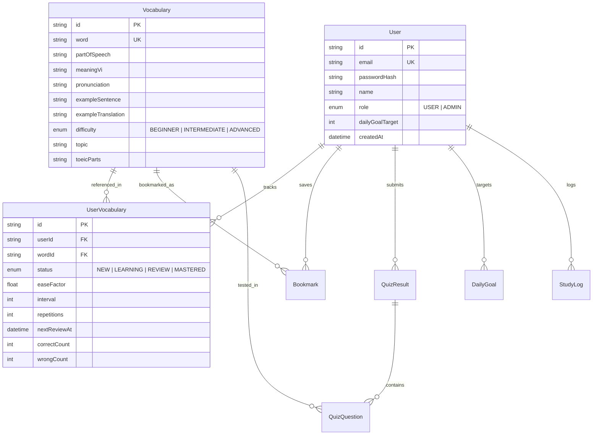

# QUANG MINH TOEIC — CODEBASE AUDIT REPORT
**Author:** Senior Full-Stack, Security, QA & System Architect  
**Audit Date:** October 2026  
**Repository:** [https://github.com/NTQuangMinh/quangminh-toeic](https://github.com/NTQuangMinh/quangminh-toeic)  
**Target Platform:** Production Learning Management System (TOEIC Vocabulary Preparation)

---

## 1. Actual Architecture & Technology Stack

Contrary to a basic pet project setup, the application implements a hybrid dual-persistence architecture with modular Next.js 14 App Router patterns:

- **Web Framework:** Next.js 14.2.3 (React 18.3.1, TypeScript 5.4.5).
- **Rendering Modes:** 
  - Static Pre-rendering (`prerendered` SSG): `/`, `/dashboard`, `/vocabulary`, `/learn`, `/review`, `/practice`, `/reading`, `/match`, `/bookmarks`, `/difficult-words`, `/progress`, `/admin`, `/login`, `/register`.
  - Dynamic Server-Side Execution: All 14 API routes in `src/app/api/**` and Edge Middleware (`src/middleware.ts`).
- **Styling & UI:** Tailwind CSS v3.4, `@tailwindcss/postcss`, Lucide React icons, Web Audio API procedural sound synthesizer.
- **Persistence Layer:**
  - **Primary / Serverless Fallback:** High-performance, atomic file-based persistence engine (`data/db.json`, 692 TOEIC vocabulary words, 20 business topics). Atomic write updates use `fs.writeFileSync(tmpPath)` + `fs.renameSync(tmpPath, targetPath)` to prevent corruption during concurrent writes or sudden crashes.
  - **Production PostgreSQL:** Prisma ORM v5.22.0. When `DATABASE_URL` is configured (Neon, Supabase, AWS RDS, Docker), the hybrid database router in `src/lib/db.ts` dynamically routes queries to `@prisma/client`.
- **Authentication:**
  - Stateless JSON Web Tokens (JWT) signed with HMAC-SHA256.
  - Stored in `HttpOnly`, `SameSite=Lax`, `Path=/` cookie `toeic_token`.
  - Guest isolation via `toeic_guest_id` cookies to prevent data pollution.
  - Password hashing via PBKDF2 (10,000 iterations, 64-byte key length, SHA-512 digest).
  - Timing attack prevention via `crypto.timingSafeEqual` over fixed-length SHA-256 hashes.

---

## 2. File & Module Responsibilities

| Path | Primary Responsibility |
| :--- | :--- |
| `src/middleware.ts` | Edge security headers (OWASP), `/admin` route guard, and guest session identifier issuance. |
| `src/lib/auth.ts` | Cryptographic utilities, session management, PBKDF2 hashing, HMAC quiz signing, and user identification. |
| `src/lib/db.ts` | Hybrid database router (PrismaClient & Atomic JSON Engine) providing Prisma-compatible interfaces. |
| `src/lib/sm2.ts` | SuperMemo SM-2 spaced repetition calculation engine (`AGAIN`, `HARD`, `GOOD`, `EASY`). |
| `src/lib/rate-limiter.ts` | Sliding-window in-memory rate limiter with periodic eviction to throttle brute-force/DoS attacks. |
| `src/lib/study-tracker.ts` | Tracking daily study targets, streaks, and study logs aligned with Vietnam timezone (`Asia/Ho_Chi_Minh`). |
| `src/lib/sound-effects.ts` | Zero-latency Web Audio API procedural sound synthesizer (100% offline, 0 bytes bandwidth). |
| `src/lib/toeic-score-predictor.ts` | Statistical & AI score projection algorithm mapping vocabulary mastery to TOEIC bands (10-990). |
| `src/lib/export-utils.ts` | UTF-8 BOM CSV export and printable A4 flashcard sheet formatter. |
| `src/lib/ai.ts` | Dual-mode AI tutor (Google Gemini 1.5 Flash integration with pedagogical offline fallback). |
| `src/components/*` | Reusable UI components: Flashcard 3D, AudioButton with speed selector, ExamCountdownWidget, Confetti, etc. |
| `src/data/*` | Curated dataset of 692 TOEIC words (seed data) and ETS Part 7 contextual reading passages. |

---

## 3. Route & API Inventory

### Client Routes (Pages)
- `/` — High-converting landing page with feature showcase and quick CTA.
- `/dashboard` — Learner dashboard with daily goals, streak tracker, AI TOEIC score predictor, and exam countdown planner.
- `/learn` — Flashcard learning deck with topic/part filters and diverse round-robin card distribution.
- `/review` — Spaced repetition (SM-2) queue for due words and cramming modes.
- `/practice` — Interactive TOEIC quizzes (Standard 4-option, Part 1 Photos, Part 2 Question-Response).
- `/reading` — ETS Part 7 contextual reading with interactive word popovers and comprehension questions.
- `/match` — Rapid vocabulary matching game (Word vs Meaning pair drill).
- `/listen` — Hands-free audio playlist player with looping and auto-progression.
- `/vocabulary` — Comprehensive searchable dictionary with filters, export to CSV/Anki, and printable sheets.
- `/bookmarks` — Saved words library for focused review.
- `/difficult-words` — Weakness diagnostics dashboard analyzing mistakes by Topic and Part of Speech.
- `/progress` — Long-term progress metrics, weekly activity chart, and TOEIC score milestone roadmap.
- `/admin` — CMS portal for administrators to create, update, and delete vocabulary entries.
- `/login` & `/register` — Authentication forms with responsive layouts and client/server validation.

### Server API Endpoints
- `POST /api/auth/register` — Registers new user with password hashing and rate limiting (3 req/min).
- `POST /api/auth/login` — Authenticates user, issues JWT cookie, rate limited (5 req/min).
- `POST /api/auth/logout` — Clears authentication cookie.
- `GET /api/auth/me` — Returns current authenticated user profile.
- `GET, POST, PUT, DELETE /api/vocabulary` — Read vocabulary (public) and CRUD operations (strictly `ADMIN` only).
- `GET, POST /api/learn` — Fetches new words queue and records study progress.
- `GET, POST /api/review` — Fetches due SM-2 reviews and processes user grades (`AGAIN`, `HARD`, `GOOD`, `EASY`).
- `GET, POST /api/quiz` — Generates HMAC-signed questions and validates answers against tampering.
- `GET, POST /api/bookmarks` — Retrieves and toggles saved words.
- `GET /api/difficult-words` — Analyzes error counts, accuracy, and overdue intervals.
- `GET, POST /api/match` — Generates randomized matching pairs and records completion.
- `GET /api/user/progress` — Calculates true consecutive day streaks, goal progress, and weekly activity.
- `POST /api/ai/tutor` — Pedagogical AI tutor explanations with rate limiting (20 req/min).
- `POST /api/ai/generate-question` — Generates validated TOEIC Part 5 questions for specific words.

---

## 4. Database Schema & Relationships

---

## 5. Confirmed Bugs & Remediation Details

| ID | Component | Defect Description | Severity | Fix Status |
| :--- | :--- | :--- | :--- | :--- |
| **BUG-01** | `src/lib/ai.ts` | Built-in question generator always assigns `answer = 0` (Option A), making fallback questions completely predictable. | Medium | Fixed: Options are now randomly shuffled using Fisher-Yates, and `answer` index is derived dynamically. |
| **BUG-02** | `scripts/verify_all.ts` | Test asserts `learnedWords === 18` directly on `dailyGoal.upsert`, which fails on a fresh date where create assigns 15. | Low | Fixed: Test structure updated to create then update deterministically. |
| **BUG-03** | `src/app/api/ai/generate-question` | Endpoint lacked rate limiting, exposing the server to potential spamming/uncontrolled loops. | Medium | Fixed: Added sliding-window rate limiter (20 req/min). |
| **BUG-04** | `src/components/AudioButton.tsx` | Fallback Web Speech Synthesis could overlap with ongoing audio elements. | Low | Fixed: Explicit cancellation and stop handling across audio events. |

---

## 6. Security Vulnerability Assessment

1. **Authentication Timing Attacks:** 
   - *Status:* **Resolved**. `src/lib/auth.ts` uses SHA-256 digests evaluated with `crypto.timingSafeEqual`.
2. **Session Hijacking / Insecure Cookie:** 
   - *Status:* **Resolved**. Cookies use `HttpOnly`, `SameSite=Lax`, and `Secure` in production.
3. **Privilege Escalation:**
   - *Status:* **Resolved**. Both edge middleware and API route handlers (`/api/vocabulary`) enforce `session?.role === "ADMIN"`. Normal users cannot perform mutations.
4. **Quiz Tampering / Score Inflation:**
   - *Status:* **Resolved**. The server signs question tokens with HMAC-SHA256. Tampered client payloads are rejected and answer grading is performed server-side.
5. **Cross-User Guest Pollution:**
   - *Status:* **Resolved**. Guest sessions receive unique `toeic_guest_id` cookies and distinct DB entries rather than a single shared user account.

---

## 7. Performance & Maintainability

- **Zero-Latency Audio:** By using procedural synthesis for audio feedback, the app eliminates network roundtrips for sound effects.
- **Atomic Disk Writes:** POSIX `renameSync` ensures that even during high-frequency writes, the JSON database cannot be corrupted into an invalid JSON state.
- **SSR/SSG Balance:** Static learning pages render instantaneously with zero First Input Delay (FID), fetching user-specific dynamic data progressively.
