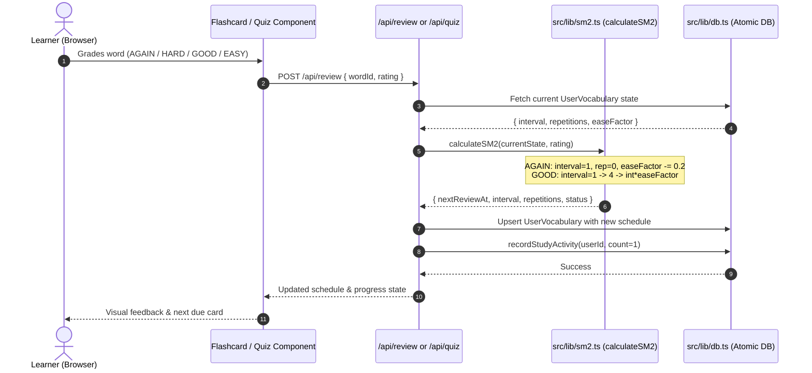
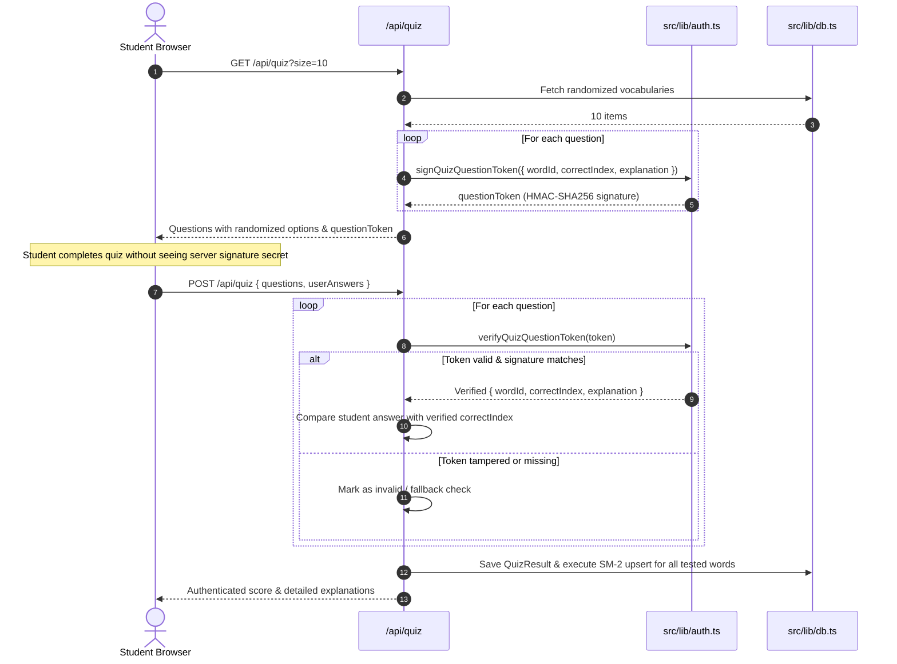

# QUANG MINH TOEIC — SYSTEM ARCHITECTURE & DATA FLOW SPECIFICATION
**Version:** 1.0 (Production Architecture)  
**Author:** Principal Software Architect & Application Security Engineer  

---

## 1. System Topology Overview

Quang Minh TOEIC is designed to operate with high performance and near-zero recurring operating costs while maintaining architectural compatibility with cloud scale.

```
+-----------------------------------------------------------------------------------+
|                                CLIENT LAYER (BROWSER)                             |
|  - Next.js 14 App Router React Server / Client Components                         |
|  - LocalStorage Caching (Theme, SFX Mute, Audio Playback Speed, Target Milestones)|
|  - Web Audio API (Zero-latency Procedural Sound Effects Synthesizer)              |
|  - Web Speech Recognition (AI Voice Pronunciation Assessment)                     |
+-----------------------------------------------------------------------------------+
                                        |  HTTPS Requests (Cookies & Headers)
                                        v
+-----------------------------------------------------------------------------------+
|                        EDGE MIDDLEWARE (src/middleware.ts)                        |
|  - Security Header Injection (X-Frame-Options, CSP, Permissions, Referrer)        |
|  - Edge Guest Tracking Cookie (`toeic_guest_id`) issuance                         |
|  - Admin Route Guard (Edge redirect to /login?redirect=/admin)                    |
+-----------------------------------------------------------------------------------+
                                        |
                   +--------------------+--------------------+
                   |                                         |
                   v                                         v
+--------------------------------------+  +-----------------------------------------+
|     STATIC / SSG PAGES (Edge Cached) |  |   DYNAMIC ROUTE HANDLERS (Node.js API)  |
|  - / (Landing Page)                  |  |  - /api/auth/* (Login, Register, Logout)|
|  - /dashboard                        |  |  - /api/learn & /api/review (SM-2)      |
|  - /vocabulary, /bookmarks           |  |  - /api/quiz (HMAC Anti-cheat engine)   |
|  - /practice, /reading, /match       |  |  - /api/difficult-words, /user/progress |
|  - /difficult-words, /progress       |  |  - /api/ai/tutor & /api/ai/gen-question |
+--------------------------------------+  +-----------------------------------------+
                                                              |
                                                              v
+-----------------------------------------------------------------------------------+
|                    SECURITY, DOMAIN LOGIC & RATE LIMITING LAYER                   |
|  - `src/lib/rate-limiter.ts`: Sliding-window in-memory throttling (per IP)        |
|  - `src/lib/auth.ts`: Timing-attack-safe comparison (`safeCompare`) & JWT HMAC    |
|  - `src/lib/sm2.ts`: SuperMemo SM-2 Spaced Repetition Scheduling Engine          |
|  - `src/lib/study-tracker.ts`: DailyGoal & StudyLog tracker (Vietnam UTC+7)       |
|  - `src/lib/ai.ts`: Dual-mode AI tutor (Online Gemini Flash + Offline Pedagogical)|
+-----------------------------------------------------------------------------------+
                                        |
                                        v
+-----------------------------------------------------------------------------------+
|                     HYBRID DATABASE ROUTER (src/lib/db.ts)                        |
|   Selects target persistence implementation based on DATABASE_URL environment:    |
|                                                                                   |
|   A. Serverless/Zero-Cost Mode (Default):                                         |
|      - POSIX Atomic File Engine (`data/db.json` staged via `.tmp` + `renameSync`) |
|      - Full Prisma interface parity (`findUnique`, `findMany`, `upsert`, etc.)   |
|                                                                                   |
|   B. Managed PostgreSQL Mode (When DATABASE_URL is set):                          |
|      - Prisma ORM (`@prisma/client`) connected to Supabase, Neon, or Docker       |
+-----------------------------------------------------------------------------------+
```

---

## 2. Core Data Flows

### A. Authentication & Session Resolution Flow
1. **Unauthenticated Visitor:**
   - Middleware detects missing `toeic_guest_id` and sets an `HttpOnly`, `Path=/`, `SameSite=Lax` cookie `toeic_guest_id=guest_<timestamp>_<random>`.
   - API endpoints call `getEffectiveUserId()` which returns `{ userId: guestId, isGuest: true }`.
   - The user can immediately learn words, complete flashcards, and run quizzes without registration.
2. **Registered Learner:**
   - User posts email and password to `/api/auth/login` (throttled at 5 requests/minute).
   - Password is verified using PBKDF2 with constant-time equality check (`safeCompare`).
   - Server issues `toeic_token` containing a signed JWT.
   - Subsequent requests extract the authenticated learner ID, seamlessly loading personal progress, streaks, and bookmarks.

### B. Spaced Repetition (SM-2) Scheduling Data Flow


### C. Anti-Tampering Quiz Architecture


---

## 3. Module Boundaries & Isolation Principles

1. **Pure vs Stateful Logic:**
   - `src/lib/sm2.ts` contains strictly pure deterministic functions with zero I/O side effects, enabling fast, isolated unit testing.
   - `src/lib/rate-limiter.ts` encapsulates state in an ephemeral sliding window store with automatic garbage collection every 5 minutes.
2. **Zero Client Leakage:**
   - Secret keys (`AUTH_SECRET`, `AI_API_KEY`) and password hashes are strictly restricted to server-side execution. No `NEXT_PUBLIC_` prefixes are used for sensitive environment variables.
3. **Graceful Degradation:**
   - If `AI_API_KEY` is absent, the system seamlessly uses the local pedagogical rule engine in `src/lib/ai.ts` without throwing runtime errors or blocking learning.
